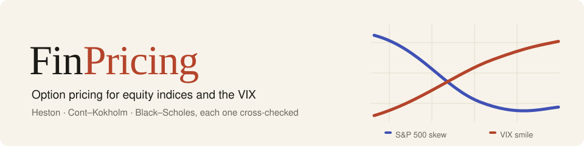
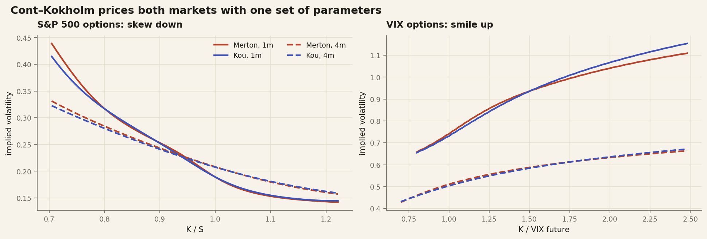
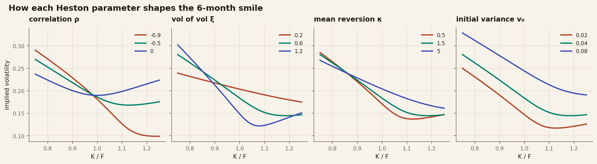
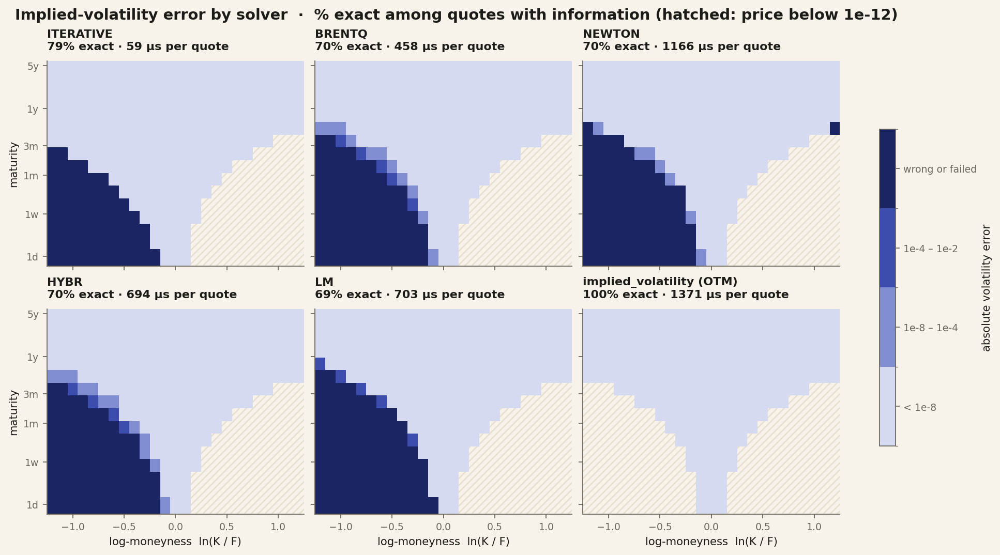
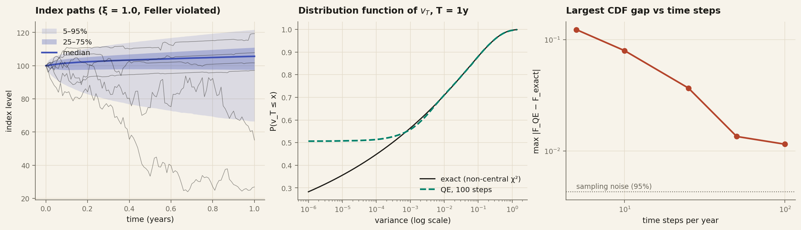
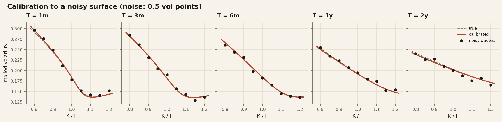

<p align="center">
  
</p>

<p align="center">
  
  
  
  
</p>

**FinPricing** prices equity index options and VIX derivatives with three models, from
Black–Scholes to a jump model that fits both markets at once. Every model has pricing,
simulation and calibration, a page of maths, and notebooks whose figures double as tests:
each one checks the model against an independent method and stops if they disagree.

<p align="center">
  
  <br>
  <sub>One parameter set, two markets: the Cont–Kokholm model reproduces the S&P 500 skew and the upward VIX smile
  (<a href="notebooks/02_cont_kokholm.ipynb">notebook 02</a>).</sub>
</p>

## Models

| | Pricing | Simulation | VIX | Calibration | Maths |
|---|---|---|---|---|---|
| **Heston** | Lewis integral, Kar–Madan and Cont–Tankov FFT | Andersen QE | closed-form futures and options | ✓ | [heston.md](docs/heston.md) |
| **Cont–Kokholm** | Fourier (VIX), conditional Monte Carlo (index) | Merton or Kou jumps | joint with the index | ✓ | [cont_kokholm.md](docs/cont_kokholm.md) |
| **Black–Scholes** | vectorised prices, Greeks, implied volatility | | | | [black_scholes.md](docs/black_scholes.md) |

## Quickstart

```bash
git clone https://github.com/VardanVoskanyan/fin_price.git && cd fin_price
uv sync --extra dev
```

```python
import numpy as np
from finpricing import HestonModel, HestonParameters

model = HestonModel(HestonParameters(v0=0.04, kappa=1.5, theta=0.04, xi=0.5, rho=-0.7))
strikes = np.array([80, 90, 100, 110, 120])

model.option_price(S0=100, K=strikes, T=0.5, r=0.03)   # array([21.890, 13.220, 6.007, 1.548, 0.220])
model.implied_vol(S0=100, K=strikes, T=0.5, r=0.03)    # array([0.255, 0.222, 0.187, 0.155, 0.142])
model.vix_future(T=0.25)                               # 0.177
times, S, v = model.simulate(S0=100, T=1.0, r=0.03, n_paths=10_000, seed=0)
```

<details>
<summary><b>Calibration, Cont–Kokholm and Black–Scholes examples</b></summary>

Calibrators take an `OptionSurface`: strikes, maturities and prices as arrays, plus spot,
rate and dividend yield (`OptionSurface.from_columns` also accepts a dict or a `DataFrame`).

```python
from finpricing.calibration import HestonCalibrator, OptionSurface

K, T = np.meshgrid([85, 95, 100, 105, 115], [0.25, 0.5, 1.0])
K, T = K.ravel(), T.ravel()
surface = OptionSurface(strike=K, maturity=T, spot=100, r=0.03,
                        price=model.option_price(100, K, T, 0.03))
params, info = HestonCalibrator().calibrate(surface)
info['iv_rmse']   # below 1e-6: recovers the parameters that generated the prices
```

```python
from finpricing import VixModel

ck = VixModel(model_type='Kou')                                   # paper parameters (Table 2)
ck.vix_option_pricer(S0=0.20, K=0.22, T=1/12, r=0.0)              # VIX call, Fourier
ck.index_option_pricer(S0=100, strikes=strikes, tenor_index=2)    # index calls, Monte Carlo
```

```python
from finpricing.utils.bs_utils import bs_price, implied_volatility

prices = bs_price(100, strikes, 0.5, 0.03, 0.2, option_type='put')
implied_volatility(prices, 100, strikes, 0.5, 0.03, option_type='put')   # all 0.2
```

</details>

## Notebooks

Each notebook is a worked example and a test suite: cells marked **PASS** compare the model
with an independent method and raise if they disagree. They run in under half a minute each.

| | Notebook | What it shows | Checks |
|---|---|---|---|
| 01 | [Implied volatility](notebooks/01_implied_volatility.ipynb) | Where five implied-vol solvers fail on a 1-day to 5-year grid, and why inverting out-of-the-money options fixes it | 8 |
| 02 | [Cont–Kokholm](notebooks/02_cont_kokholm.ipynb) | Paper replication: VIX smiles, VIX term structure, index surface, both markets with one parameter set | 8 |
| 03 | [Cont–Kokholm checks](notebooks/03_cont_kokholm_checks.ipynb) | Martingale tests, FFT vs FFT, Fourier vs Monte Carlo, jump moments, Monte Carlo convergence | 9 |
| 04 | [Heston](notebooks/04_heston.ipynb) | Three pricers agree, smile anatomy, QE vs the exact variance law, VIX, calibration round trip | 16 |

<table>
  <tr>
    <td width="50%"><a href="notebooks/04_heston.ipynb"></a></td>
    <td width="50%"><a href="notebooks/01_implied_volatility.ipynb"></a></td>
  </tr>
  <tr>
    <td><sub>How ρ, ξ, κ and v₀ shape the Heston smile</sub></td>
    <td><sub>Where implied-volatility solvers break, and the fix</sub></td>
  </tr>
  <tr>
    <td><a href="notebooks/04_heston.ipynb"></a></td>
    <td><a href="notebooks/04_heston.ipynb"></a></td>
  </tr>
  <tr>
    <td><sub>Monte Carlo against the exact law of the variance, with Feller violated</sub></td>
    <td><sub>Calibration to a noisy surface recovers the true smiles</sub></td>
  </tr>
</table>

To run them:

```bash
uv sync --extra notebook
uv run --with jupyterlab jupyter lab
```

## Installation

Requires Python 3.12+ and [uv](https://docs.astral.sh/uv/getting-started/installation/).
The core library needs only numpy, scipy and pydantic; everything else is an optional extra.

| Extra | Adds | For |
|---|---|---|
| `dev` | pytest, ruff, mypy, maturin | tests and linting |
| `notebook` | ipykernel, matplotlib | the notebooks |
| `data` | pandas, yfinance | market data and `DataFrame` input |
| `ml` | torch, torchsde, gpytorch | planned machine-learning models |

The Cont–Kokholm jump simulation has an optional Rust extension in `rust/` (PyO3 + rayon);
without it a pure-Python version is used automatically. To build it, install the Rust
toolchain and run `uv run maturin develop --release`.

## Tests

```bash
uv run pytest            # fast suite
uv run pytest -m slow    # end-to-end calibrations (~20 s)
```

## Project layout

```
src/finpricing/
├── models/
│   ├── black_scholes/   Black–Scholes model and implied-volatility solvers
│   ├── heston/          Heston pricing, simulation, VIX
│   ├── jump_diffusion/  Merton and Kou jump simulation
│   └── vix/             Cont–Kokholm VIX and index option pricing
├── calibration/         OptionSurface and model calibrators
├── data/                Paper fixtures (Cont–Kokholm Table 2)
└── utils/               Characteristic functions, Fourier pricing, Black–Scholes utilities
docs/                    Maths for each model
notebooks/               Worked examples that double as model checks
rust/                    Optional Rust extension for jump simulation
tests/                   pytest suite
```

## References

- R. Cont, T. Kokholm. *A consistent pricing model for index options and volatility derivatives.* Mathematical Finance 23(2), 2013.
- S. Heston. *A closed-form solution for options with stochastic volatility.* Review of Financial Studies 6(2), 1993.
- L. Andersen. *Simple and efficient simulation of the Heston stochastic volatility model.* Journal of Computational Finance 11(3), 2008.
- A. Lewis. *A simple option formula for general jump-diffusion and other exponential Lévy processes.* 2001.

## License

[MIT](LICENSE)
